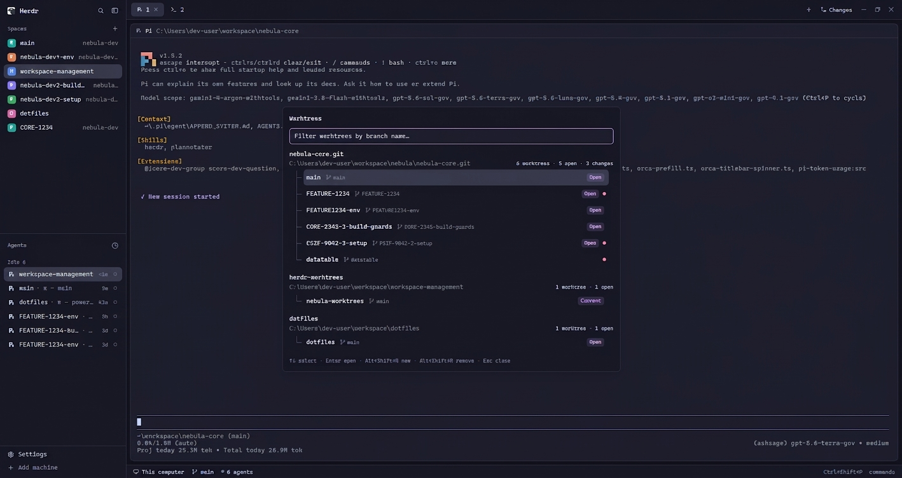

# Herdr Worktrees

A floating window for browsing Git worktrees as grouped repository lists, switching workspaces, and creating worktrees from eligible local branches.

## Preview



## Use

Open or toggle the floating Worktrees window:

```sh
herdr-app do mod.open --name worktrees
```

Default global shortcut: `Alt+Shift+W`.

- `↑` / `↓` changes the highlighted result while leaving the input focused and scrolls an offscreen selection into view. These have mod-specific mappings because Herdr's native input consumes arrow keys before the mod can observe them.
- `Enter` opens the highlighted worktree.
- The configured **new worktree** shortcut begins the new-worktree flow (default: `Alt+Shift+N`).
- The configured **remove worktree** shortcut opens this mod's removal confirmation for any non-main highlighted worktree (default: `Alt+Shift+R`). It closes an associated Herdr space first, then uses `git worktree remove --force`; clean worktrees remove with Enter, while a worktree with uncommitted or untracked changes requires its folder name to be typed case-insensitively. Removal errors remain visible until the flow is retried or closed and have a **Copy error** button. If Git unregisters the worktree but leaves its folder behind, a second typed confirmation offers direct folder cleanup. A successful removal returns to the Worktrees list and refreshes it.
- `Esc` goes back or closes the Worktrees window. It has a mod-specific mapping because Herdr's native input consumes Escape before the mod can observe it.

The bottom hint reads Herdr's live `mod:worktrees` key bindings, so it updates when either action's mapping changes.

The create flow lists local branches not already checked out by a worktree. It checks out the selected branch at `~/.herdr/worktrees/<repo>/<folder-name>` and opens it as a new Herdr space.

## Validation

```sh
npm test
npm run check
npm run validate
```

`npm test` covers pure Git-data helpers and the default `keys.json` contract. The key contract protects the input-safe mappings for `↑`, `↓`, and `Esc`, plus the default new/remove shortcuts. `npm run check` runs Herdr's load/render validation. It does not simulate interactive focus, keyboard routing, Git, or asynchronous behavior; verify those in the live app after validation.

## Future end-to-end testing

Herdr currently exposes `herdr-app check` for headless initial-load/render validation, but it cannot open a live overlay, synthesize keyboard input, or assert native focus. A future end-to-end suite should use Windows UI Automation against a running Herdr window to:

1. Open `worktrees` with `herdr-app do mod.open --name worktrees`.
2. Assert the filter input owns keyboard focus.
3. Send `↑`, `↓`, `Enter`, `Esc`, and the configured new/remove shortcuts.
4. Verify focus remains in the input while the highlighted row changes.
5. Exercise the branch chooser and worktree-name screens.

Run those tests in a dedicated Herdr profile/configuration and fixture Git repository so they cannot create or remove a person's real worktrees. Keep them separate from `npm test`: native UI tests require a visible desktop session and are expected to be slower and more environment-dependent.
