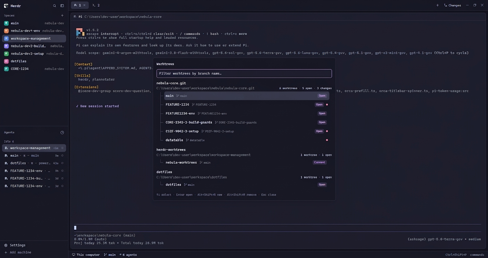

# Herdr Worktrees

A floating window for navigating Git worktrees already represented by Herdr spaces. It groups checkouts under each repository's main folder, lets the person filter and select a worktree with the keyboard, and creates a new checkout from an eligible local branch. The window follows the active Herdr theme and uses a centered spinner while Git data is loading.

## What you see

The window has a title, then either its content or a centered loading state. Loading uses a 22px spinning branch icon above muted text (`Loading worktrees…` or `Loading branches…`).

The main screen has a 34px filter input and a scrollable list. Every repository group shows its short repository name, optional machine name, and main checkout path. Its worktrees are 38px rows with the branch name, `main` for the primary checkout, `open` for a worktree already shown by a Herdr space, and a clean/changes status. The selected row uses the theme's selected color.

The new-worktree flow first shows a branch filter and a scrollable local-branch list, then a name screen with a folder-name input. The name starts as the chosen branch name.

## How it behaves

The filter input always retains keyboard focus; no list-focus state exists. The first visible worktree is selected. `↑` and `↓` wrap the highlighted result without leaving the input. `Enter` opens it. The configured new-worktree action (default `Alt+Shift+N`) starts creation in its repository, and the configured remove action (default `Alt+Shift+R`) opens safe removal for a non-main worktree that has a Herdr space. The bottom hint reads the live mod key bindings. `Esc` backs out of creation or closes the window. `Tab` has no mapping.

Creating lists local branches that are not currently checked out in any worktree. Enter on a branch continues to naming. Enter on the name creates `~/.herdr/worktrees/<repo>/<folder-name>`, checks out the selected branch there, and starts a new Herdr space. The folder name is sanitized into one safe path component.

## Built from

`mods/worktrees/mod.json` registers a `place: none` mod with a 680×540 floating window. `main.js` is a GPUI `View`; it reads spaces and panes, runs Git with `exec`, opens spaces with `space.select`/`space.new`, and opens the shipped `worktree` removal dialog with `openOverlay`. It uses `spinner.svg` with native `.spin(900)`.

`model.js` contains pure helpers for parsing `git worktree list --porcelain`, branch eligibility/filtering, IDs, and safe folder slugs. Node's built-in test runner tests those helpers in `test/model.test.js`.

## Watch out

Only repositories with an existing Herdr space appear. The Worktrees window lists local branches only and intentionally omits any branch already checked out by a worktree. Removal relies on Herdr's shipped `worktree` mod. `herdr-app check` validates initial loading and eager UI construction, not keyboard focus, async Git calls, or live layout behavior.

## Done when

- `npm test` passes.
- `herdr-app check mods/worktrees` passes.
- The Worktrees window opens with its filter focused; `↑` and `↓` change the highlighted result while that input remains focused.
- The new-worktree screen shows a centered spinner while branches load, then focuses its branch filter.
- Creating a checkout opens it in a new Herdr space.
